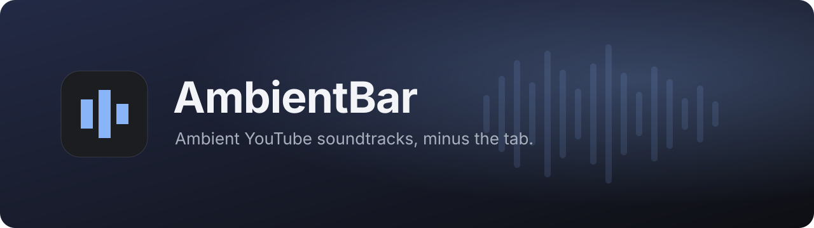
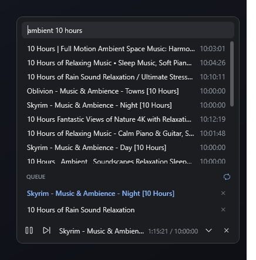
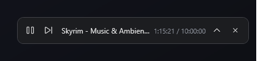

<p align="center">
  
</p>

<p align="center">
  <a href="https://github.com/vikpek/AmbientBar/releases/latest"></a>
  <a href="https://github.com/vikpek/AmbientBar/releases"></a>
  
  <a href="https://github.com/vikpek/AmbientBar/actions/workflows/ci.yml"></a>
  <a href="LICENSE"></a>
</p>

<p align="center">
  <a href="https://github.com/vikpek/AmbientBar/releases/latest/download/AmbientBar.exe"><b>⬇&nbsp; Download the latest AmbientBar.exe</b></a>
  &nbsp;·&nbsp;
  <a href="https://vikpek.github.io/AmbientBar/">Website</a>
  &nbsp;·&nbsp;
  <a href="https://github.com/vikpek/AmbientBar/releases">All releases</a>
  &nbsp;·&nbsp;
  <a href="CHANGELOG.md">Changelog</a>
</p>

---

A tiny Windows player for long YouTube ambient tracks. It sits as a slim bar in the corner of your screen and streams only the audio, so there's no video and no browser tab. It works with your keyboard's media keys.

<p align="center">
  
  &nbsp;&nbsp;
  
</p>

## Features

- **Audio only.** It streams just the audio, so it uses little bandwidth and CPU.
- **Docks above the taskbar.** It sits in the bottom-right corner, stays on top, and hides to the tray with one click.
- **Media keys and the Windows media flyout.** Play/Pause/Next keys, headset buttons and the volume-flyout controls all work. The flyout shows the track's thumbnail.
- **Plain-text search.** Results show only titles and lengths. You can also paste a YouTube video or playlist link.
- **Short queue with repeat.** Built for one to three long tracks.
- **Resumes where you left off.** The queue, track, position and volume are saved. If a stream link expires partway through a 10-hour track, it gets a fresh one and continues from the same spot.
- **Update notice.** When a new release is out, it shows up in the tray menu.

## Install

1. **[Download `AmbientBar.exe`](https://github.com/vikpek/AmbientBar/releases/latest/download/AmbientBar.exe).** That link always points to the newest release. It's a single self-contained file, with no installer and no .NET runtime to install.
2. **Recommended:** install [yt-dlp](https://github.com/yt-dlp/yt-dlp), which AmbientBar uses for search and streaming:
   ```powershell
   winget install yt-dlp.yt-dlp
   ```
   This also installs Deno, which yt-dlp needs for YouTube. If yt-dlp isn't installed, AmbientBar downloads its own copy to `%LOCALAPPDATA%\AmbientBar` the first time you search.
3. Run it. If Windows SmartScreen warns about an unrecognized app (the exe isn't code-signed), click **More info → Run anyway**.

> **Start with Windows:** press <kbd>Win</kbd>+<kbd>R</kbd>, type `shell:startup`, and put a shortcut to `AmbientBar.exe` in that folder.

## Controls

| Action | How |
| --- | --- |
| Search | Click the title or <kbd>^</kbd>, type, press <kbd>Enter</kbd> |
| Queue a result | Click it. If nothing is playing, it starts right away |
| Play from the queue | Click the track |
| Remove from the queue | The <kbd>×</kbd> next to it |
| Play / pause / next | Bar buttons, keyboard media keys, or the Windows media flyout |
| Volume | Scroll the mouse wheel over the bar |
| Repeat queue | Loop icon next to **QUEUE** (on by default) |
| Collapse | <kbd>Esc</kbd>, or click anywhere else |
| Hide / show | Left-click the tray icon |
| Quit | <kbd>×</kbd> on the bar, or **Quit** in the tray menu |

Your state is saved in `%APPDATA%\AmbientBar\state.json`. Delete it to start fresh.

## FAQ

<details>
<summary><b>Do I need YouTube Premium?</b></summary>

No. AmbientBar doesn't sign in to YouTube. It streams the audio through yt-dlp.
</details>

<details>
<summary><b>Search or playback suddenly stopped working.</b></summary>

YouTube changes things often. Update yt-dlp with `winget upgrade yt-dlp.yt-dlp`. If AmbientBar is using its own copy, it updates that copy weekly.
</details>

<details>
<summary><b>Why is the exe ~70 MB?</b></summary>

It includes the .NET runtime, so nothing needs to be installed. That makes it larger than an app that relies on an installed runtime.
</details>

## Building from source

Requires the [.NET 10 SDK](https://dotnet.microsoft.com/download).

```powershell
git clone https://github.com/vikpek/AmbientBar
cd AmbientBar
dotnet run --project src/AmbientBar
```

The project is small. `MainWindow.xaml(.cs)` has the UI and playback (Windows `MediaPlayer`, which provides the system media controls). `YtDlp.cs` handles search and stream resolution, and `Updates.cs` checks for new releases.

## Releasing

Update [`CHANGELOG.md`](CHANGELOG.md), then push a version tag:

```powershell
git tag v0.2.0
git push origin v0.2.0
```

The [Release workflow](.github/workflows/release.yml) builds a self-contained `AmbientBar.exe`, publishes a GitHub Release with generated notes and a SHA-256 checksum, and the download links above then point to it.

## License

[MIT](LICENSE). AmbientBar is not affiliated with YouTube or Google. Please respect the terms of the content you play.
